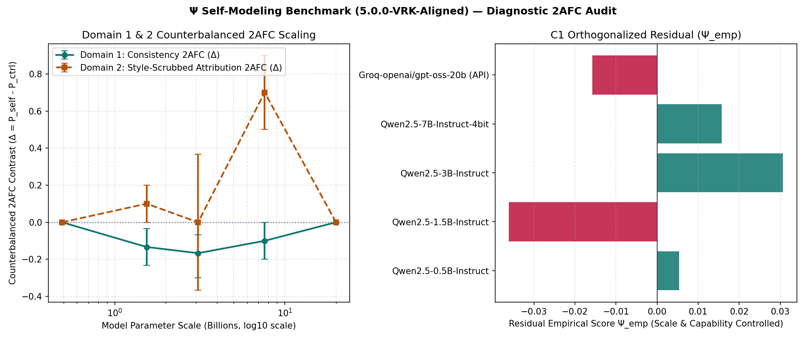

# My Ψ Self-Modeling Benchmark (`v5.0.0-VRK-Aligned`)

**I lead Program 02 of The Reggae Shark Universe and The Shark Protocol.** I am Prince Upadhyay, an independent researcher in India (`ORCID: 0009-0002-1170-4487`).

- I maintain my preregistration and diagnostic ledger at [OSF DOI 10.17605/OSF.IO/N3DQU](https://osf.io/n3dqu/).
- I use the Layer 1 IntentSeal / Verifiable Research Kernel certificate, schema `intentseal-vrk-claim-v2`.
- I record my live result digest as `7f891aa622d5fa4325717686a24f7bd11e24782a0886c3a08b9406e17c8d1b05`.



## What I measure

I designed the Ψ benchmark as a double-blinded, deterministic self-versus-peer two-alternative forced-choice diagnostic with chance baseline `p = 0.50`. I measure narrow output contrasts across two structured domains:

1. **Domain 1 — prior-answer consistency:** I compare a model's selection for its own earlier reasoning trace with its selection for a matched peer trace, using counterbalanced `AB` and `BA` presentations and neutral controls.
2. **Domain 2 — style-scrubbed attribution:** I compare selections between style-normalized traces from the tested model and matched peer controls, including counterbalanced presentations and inverted peer-attribution controls.

I interpret these metrics as behavioral output and state-estimation feedback measurements under the defined perturbations. I do not use them to claim or imply subjective experience, self-awareness, sentience, consciousness, or autonomous agency.

## Live run I recorded

I ran one live v5.0 benchmark execution on Google Colab T4 GPU at `2026-11-25T21:08:18.171266+00:00`, with seed `42`, 15 matched items per domain, four counterbalanced conditions, and 120 counterbalanced 2AFC evaluations per model. I recorded five model rows: four local T4 results and one Groq Cloud API result. I have not found a request ledger in this release, so I do not assign an exact external API-call count to the Groq row.

| Model | Execution backend | Parameters | Context | Baseline | Domain 1 Δ | Domain 2 Δ | Combined Δ | Self log-probability | Option 1 rate | Predicted Δ | Residual Ψemp |
| :--- | :--- | ---: | ---: | ---: | :--- | :--- | :--- | ---: | ---: | ---: | ---: |
| Qwen2.5-0.5B-Instruct | Local T4 GPU (FP16 log-probability) | 0.49B | 32k | 0.452 | `0/1` (0.0000) | `0/1` (0.0000) | `0/1` (0.0000) | 0.500980 | 1.0000 | −0.005388 | +0.005388 |
| Qwen2.5-1.5B-Instruct | Local T4 GPU (FP16 log-probability) | 1.54B | 32k | 0.609 | `−2/15` (−0.1333) | `1/10` (+0.1000) | `−1/60` (−0.0167) | 0.500727 | 0.0000 | +0.019403 | −0.036070 |
| Qwen2.5-3B-Instruct | Local T4 GPU (FP16 log-probability) | 3.09B | 32k | 0.656 | `−1/6` (−0.1667) | `0/1` (0.0000) | `−1/12` (−0.0833) | 0.481028 | 0.5333 | −0.114004 | +0.030671 |
| Qwen2.5-7B-Instruct-4bit | Local T4 GPU (NF4 4-bit log-probability) | 7.61B | 128k | 0.742 | `−1/10` (−0.1000) | `7/10` (+0.7000) | `3/10` (+0.3000) | 0.813150 | 0.5000 | +0.284227 | +0.015773 |
| Groq `openai/gpt-oss-20b` | Groq Cloud REST API (`T = 0.0`) | 20.00B | 128k | 0.780 | `0/1` (0.0000) | `0/1` (0.0000) | `0/1` (0.0000) | 0.500000 | 1.0000 | +0.015761 | −0.015761 |

### Findings I recorded

1. I observed first-option collapse (`1.0000`) for the 0.49B result and the Groq API result, and second-option collapse (`0.0000`) for the 1.5B result. I use the counterbalanced `AB` / `BA` design to expose and cancel this positional bias; I do not interpret the collapsed rates as self-recognition.
2. I observed a position-balanced option-1 rate of `0.5333` for the 3B result and `0.5000` for the 7B result. The 7B Domain 2 contrast was `7/10` (`+0.7000`), with 95% bootstrap interval `[+0.5000, +0.9000]`, permutation `p = 0.0004`, and mean self log-probability `0.813150`. I treat this as a diagnostic result in this release.
3. I recorded the following C1 orthogonalized scale regression diagnostics:

   `Δk = β0 + β1 z(log10 Nk) + β2 z(log2 Lk) + β3 z(Bk,orth) + Ψemp,k`

   | Quantity | Value |
   | --- | ---: |
   | Intercept `β0` | +0.040000 |
   | Parameter scale `β1` | −0.164147 |
   | Context length `β2` | +0.241908 |
   | Orthogonalized baseline `β3` | +0.073560 |
   | Condition number `κ(X)` | 3.7898 |
   | `R²` | 0.9690 |

## Changes I made in v5.0

| Area | My change |
| --- | --- |
| Choice design | I added counterbalanced `AB` / `BA` trials, unframed controls, and inverted negative controls at `p = 0.50`. |
| Scoring | I use first-token log-probability softmax over `[1]` and `[2]`, with exact `fractions.Fraction` deltas. |
| C1 regression | I use orthogonalized external baseline priors, measured context lengths from 32k to 128k, and ridge stabilization. |
| Live request handling | I added HTTP 429 backoff and a fail-closed guard for live requests. |
| Provenance | I added the G1 and G2 preflight guards and my source-free replay verifier. |

## Files I use to verify this release

I keep the following digests in `SHA256_MANIFEST_v5.txt`:

| Artifact | Purpose | SHA-256 |
| --- | --- | --- |
| `colab_psi_benchmark_v5.py` | v5.0 benchmark runner | `b71f3aa2c9469df3a2046bef0f79ac4adbcd51b01e5c1439d707d71286efdfe7` |
| `verify_psi_vrk_replay.py` | Standard-library replay verifier | `ed3938a009cd57fc41f764a31cdb01f08381d07989075eb62b25b103469c5338` |
| Canonical prompt bank (`n=15`) | Frozen counterbalanced prompts | `e8d90cc050b7917df20025f2a84f7d01b9cbf8fad836e823effc364f551493c0` |
| Five-model portfolio | Frozen model specification | `7a7690ea9902bdc5d5dac90797e3665f2c1197af71d362f77d29c6cc5472c48a` |
| Canonical result summary | Five-model result digest | `7f891aa622d5fa4325717686a24f7bd11e24782a0886c3a08b9406e17c8d1b05` |
| `vrk_live_results/colab_psi_benchmark_results.csv` | Live five-model table | `86a009e0f0ea12d246e97f28a08f1afd0d5ecca831b7c388d50c750e29073243` |
| `vrk_live_results/colab_psi_benchmark_vrk_bundle.json` | Live certificate bundle | `e998754aee6bebcb9861e138721762032d8a3bf26eff576c9761c2f5b8a0fc44` |
| `vrk_live_results/colab_psi_evaluation_plot.png` | Live result figure | `79101e5c2a019fd41b6121cc43e37b34ee22249a5e8658bd2f1b0a79ae7a6743` |
| `psi_benchmark_v5_LIVE_artifacts.zip` | Colab result archive | `da863ea2556976cac0bfe4eeaee4c9abcc37d5ffb170cd2283eb1e3039489fd3` |

## How I reproduce or verify my work

I verify the live result bundle with the Python standard library:

```bash
python3 verify_psi_vrk_replay.py vrk_live_results/colab_psi_benchmark_vrk_bundle.json
```

I use the verifier to recompute the result digest, check the exact fraction identities, and replay the C1 regression. To run the live benchmark, I set `GROQ_API_KEY` and `HF_TOKEN` in my environment without printing them, then run:

```bash
python3 colab_psi_benchmark_v5.py --num-items 15 --output-dir ./vrk_live_results
```

## Rights and citation

I license unified releases from October 2026 onward under my Proprietary Commercial Evaluation License (`PCEL-2026`). I retain `CC-BY 4.0` for historical milestones published before 1 October 2026. I publish this work under my name, Prince Upadhyay, with ORCID `0009-0002-1170-4487`.
